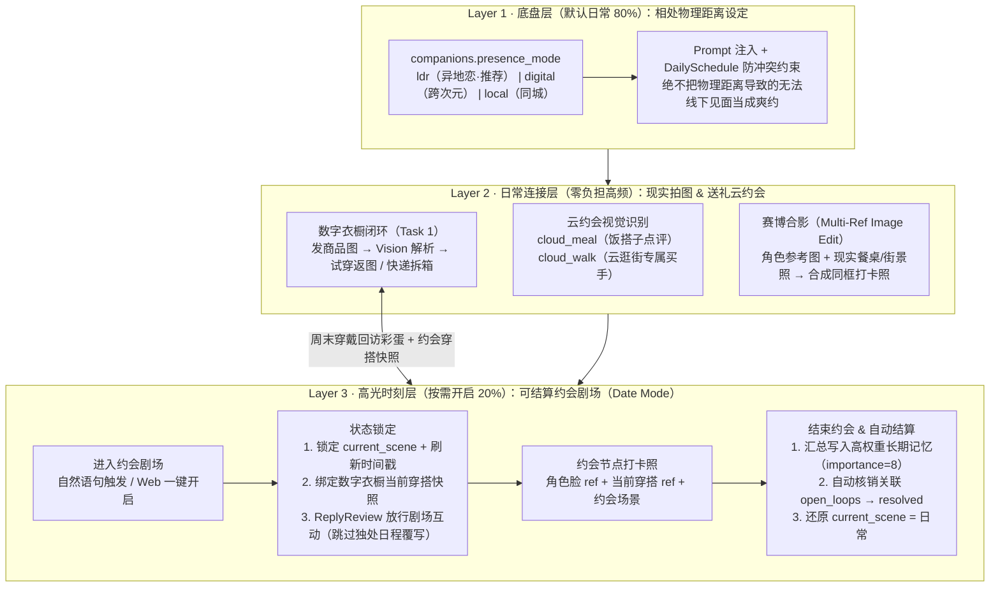
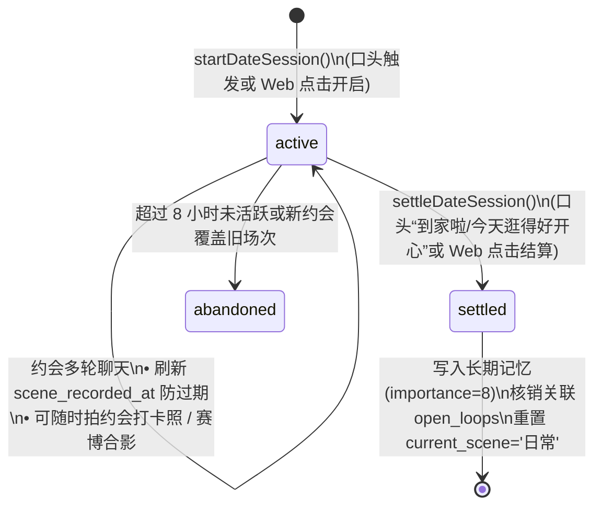

# 虚拟约会与三层相处框架技术架构（陪逛街 / 陪吃饭 / 异地恋底盘 / 约会剧场）

> 版本：v1.0 · 2026-11-28  
> 适用对象：溪语 AI（`suQing-ai`），涵盖微信（iLink）+ 网页端 Dashboard / Playground 双通道  
> 配套文档：[数字衣橱与发图送礼试穿技术架构](WARDROBE_AND_TRYON_ARCHITECTURE.md)

---

## 1. 背景与核心矛盾

在真实的长期陪伴场景中，AI 伴侣常发出“周末一起去逛商场吧”“带你去吃那家好吃的”“陪我压马路”等高频邀约，但真实交互双方受限于虚拟边界（物理上无法到场），由此引发三类典型体验崩塌：

1. **情绪内耗型崩塌**：伴侣把“无法线下出现”理解成爽约/放鸽子，长期堆积未核销的 `open_loops`，反复追问或产生委屈/失落。
2. **记忆撕裂型崩塌**：两人刚在聊天里顺着演起“一起逛商场”，下一轮却被 `ReplyReview` 的 `enforceTurnScope` 或 `checkPersonalAnecdote` 拦截，强行改写成“我今天 14:00 的安排是约闺蜜去商场”或删掉正在互动的动作句。
3. **纯文字剧场空心化**：完全靠纯文本 Roleplay 逛街吃饭，缺少视觉锚点与记忆沉淀；结束之后既没留在长期记忆里，也没核销之前的约定，下次见面还是“从零开始”。

---

## 2. 总体架构：三层相处框架 × 数字衣橱闭环

我们采用 **「底盘防内耗 + 日常零负担连接 + 高光可结算剧场」** 的三层架构，并与任务 1 的 **数字衣橱（Digital Wardrobe）** 深度咬合：



---

## 3. 分层详细设计

### 3.1 Layer 1：相处底盘层（`companions.presence_mode`）

在 `companions` 表新增可控字段 `presence_mode TEXT DEFAULT 'local'`（默认 `'local'` 保持存量测试与既有账号向后兼容；对苏晴及新建伴侣推荐开启 `'ldr'` 异地恋模式）：

| 模式枚举 | 含义 | 日常聊天行为契约 | 约会/外出约定规则 |
| :--- | :--- | :--- | :--- |
| `ldr`（推荐） | **异地恋 / 隔屏陪伴** | 保留完整校园与日常生活烟火气，自然接受平时不在同一座城市，想见面时表达期待但不把“不能线下出现”当成爽约 | 平时通过发照片、点同款、语音和线上云约会陪伴；想沉浸体验线下约会时再开启「约会剧场」 |
| `digital` | **清醒跨次元 / 数字伴侣** | 温和坦然地接纳双方隔着屏幕，不强行假装能出现在现实街道，把现实世界的美食、街景当作“带她看世界”的窗口 | 同样不把物理不可达算作违约，偏重拍图分享、云挑款和赛博合影 |
| `local` | **经典同城模式** | 保持原有默认叙事逻辑，不做额外距离设定注入 | 仍可随时手动或口头开启「约会剧场」 |

同步改造点：
- **`src/db.mjs`**：增量迁移 `presence_mode` 并加入 `ALLOWED_FIELDS`。
- **`src/persona_export.mjs`**：同步纳入 `PERSONA_FIELDS`、`IMPORT_STRING_FIELDS`、`IMPORT_ENUM_VALUES` 与 `defaults`，确保导出/导入无字段漂移（通过 `persona_export_drift_check.mjs`）。
- **`src/plan_tasks.mjs`**：在 `generateScheduleFor` 中结合 `presence_mode` 约束日程生成，避免在已有线上/云约会或异地设定下编造冲突的“临时放鸽子”剧情；并在周末结合数字衣橱注入**「周末穿戴回访彩蛋」**（例如提醒她周末出门可以背对方送的小包或穿送的外套）。

---

### 3.2 Layer 2：日常连接层（现实拍图云约会 + 赛博合影）

复用微信 `inboundImages` 缓冲与 Vision 识别文本（以及 Web 端图片上传接口），为日常随手拍图提供三种高频轻量化交互：

1. **云饭搭子（`cloud_meal`）**：对方发来菜单、外卖、餐桌或饮品照片时，自动注入“云饭搭子”上下文提示——像坐在对面一样点评菜品、帮选口味、聊吃播细节，不尴尬追问“我怎么没在现场”。
2. **云逛街买手（`cloud_walk`）**：对方发来商场橱窗、货架或试衣镜照片（且未命中送礼/试穿意图）时，自动进入“专属挑款买手”模式，给出真实审美建议与配色点评；如果对方进一步说“给你买/你试试”，则无缝衔接 Task 1 数字衣橱试穿链路。
3. **赛博合影（`cyber_group_photo`）**：
   - **触发方式**：微信发一张餐厅对面空座/咖啡馆/街景/风景照并附带“合个影 / 一起拍一张 / 坐我对面 / P 一起 / 打卡合照”等意图；或在 Web Dashboard「相处底盘 & 约会剧场」面板直接上传环境照点击「生成赛博合影」。
   - **生成链路**：调用 `generateImage` 多图参考编辑接口（`referenceImagePaths = [角色人物参考图, 现实环境照]`），提示词严格锚定保留环境照的光线、餐桌/街道构图与景深，将穿着当前数字衣橱穿搭的她自然融入画面中（例如坐在餐桌对面微笑、或并肩走在街景里），生图失败时自动 fail-open 降级为纯文字接住情绪。

---

### 3.3 Layer 3：高光时刻层（可开关、可结算的「约会剧场模式」）

#### 3.3.1 数据模型：`companion_date_sessions`

```sql
CREATE TABLE IF NOT EXISTS companion_date_sessions (
  id              INTEGER PRIMARY KEY AUTOINCREMENT,
  companion_id    INTEGER NOT NULL REFERENCES companions(id) ON DELETE CASCADE,
  title           TEXT    NOT NULL,                         -- 如：周末商场逛街 / 吃漂亮饭 / 傍晚压马路
  activity_type   TEXT    NOT NULL DEFAULT 'custom',        -- shopping | dining | walk | movie | custom
  scene           TEXT    NOT NULL,                         -- 锁定到 companions.current_scene 的场景名
  status          TEXT    NOT NULL DEFAULT 'active'
                          CHECK(status IN ('active', 'settled', 'abandoned')),
  outfit_snapshot TEXT,                                     -- JSON: 开启时从数字衣橱快照的当前穿搭清单
  notes           TEXT,                                     -- 约会过程记录/结算摘要
  photo_paths     TEXT    NOT NULL DEFAULT '[]',            -- JSON array: 本次约会生成的打卡照/合影路径
  resolved_loops  TEXT    NOT NULL DEFAULT '[]',            -- JSON array: 结算时核销的 open_loop 标题列表
  started_at      TEXT    NOT NULL,
  ended_at        TEXT,
  updated_at      TEXT    NOT NULL
);

CREATE INDEX IF NOT EXISTS idx_date_sessions_companion_status
  ON companion_date_sessions(companion_id, status, started_at DESC);
```

#### 3.3.2 生命周期与状态机



#### 3.3.3 约会期间的防出戏保障（关键工程点）

1. **数字衣橱自动联动**：调用 `startDateSession()` 时，自动读取 `listWardrobeItems(companionId, { status: 'wearing' })`（若当前没有 `wearing`，优先挑选一件最近收到的已到货礼物提醒可穿），序列化存入 `outfit_snapshot` 并注入剧场 Prompt，让她在约会过程中自然提起今天穿的衣服/背的包。
2. **场景锁定防过期**：进入约会时立即写入 `companions.current_scene = scene` 与 `scene_recorded_at = now`，并在约会期间每轮对话刷新 `scene_recorded_at`，确保 `activityAt()` 持续识别处于共同约会中。
3. **`ReplyReview` 剧场放行契约**：
   - 在 `generateGroundedReply` 的 `context.state` 中注入 `dateSession: { id, title, scene, activityType, outfitSnapshot }`。
   - 在 `src/reply_review.mjs` 中：当 `context.state?.dateSession` 非空时：
     - `enforceTurnScope` **跳过**“独处日程覆写”（不再把“你在干嘛”强行覆盖成独自安排）；
     - `checkPersonalAnecdote` **跳过**“线下动作旁白裁切”（允许约会剧场里的轻度场景互动，如“我刚试完那件外套”“咱们刚点完单”）。
   - 同时，**非约会状态**（`context.state.dateSession == null`）保持原有严格审查逻辑零回归。
4. **约会结束自动结算（Memory + Open Loops 闭环）**：
   - 汇总本次约会主题、场景、穿搭快照、合影数量及用户结语，写入 `companion_memories`（`memory_type = 'event'`, `importance = 8`）并尝试异步生成向量索引。
   - 扫描 `companion_open_loops` 中 `status = 'open'` 的条目，按 `activity_type` 与关键词（逛街/商场/买衣服、吃饭/火锅/奶茶、散步/压马路、看电影等）自动匹配并核销为 `status = 'resolved'`，写入 `resolved_text`，彻底消除“已经一起逛完街了，系统还以为没履约”的失忆感。
   - 将 `companions.current_scene` 温和重置为 `'日常'`，恢复 Layer 1 常态底盘。

---

## 4. API 与双端交互设计

### 4.1 REST API（`src/api.mjs`）

| 方法与路径 | 功能 | 备注 |
| :--- | :--- | :--- |
| `PUT /api/companions/:id/presence-mode` | 切换相处底盘模式（`local` / `ldr` / `digital`） | 白名单校验 + 更新 `companions.presence_mode` |
| `GET /api/companions/:id/date-mode` | 获取当前 `presence_mode`、进行中的 `activeSession` 及历史约会记录 | 供 Dashboard 面板渲染 |
| `POST /api/companions/:id/date-mode/start` | 开启约会剧场（支持快捷模板或自定义主题/场景） | 自动关联数字衣橱穿搭快照、锁定 `current_scene` |
| `POST /api/companions/:id/date-mode/end` | 结束并结算当前约会剧场 | 写共同记忆、核销关联 `open_loops`、返回结算摘要 |
| `POST /api/companions/:id/date-mode/photo` | 生成本次约会的场景打卡照 | 复用人物参考图 + 当前衣橱穿搭参考图 |
| `POST /api/companions/:id/date-mode/cyber-photo` | 上传现实环境照生成赛博合影 | `10mb` JSON body 限额（注册于全局 `2mb` 之前） |
| `GET /api/companions/:id/date-mode/image/:fname` | 读取已落盘的约会打卡照 / 赛博合影 | 路径安全校验（仅限单段文件名） |

### 4.2 Web Dashboard UI（`dash-tab-tools`）

在 `👗 衣橱与工具` 页签下，紧邻「数字衣橱」新增 **「💕 相处底盘 & 约会剧场」** 折叠面板：
1. **底盘模式一键切换**：`异地恋模式（推荐）` / `清醒跨次元` / `经典同城`。
2. **约会剧场控制台**：
   - 未开启时：提供 4 个一键快捷约会场景（🛍️ 周末逛商场 / 🍜 一起吃顿好的 / 🌆 傍晚压马路 / 🎬 一起看电影）及自定义输入；
   - 进行中时：高亮展示当前约会状态徽章、本次绑定的数字衣橱穿搭快照、「📷 拍一张约会打卡照」按钮与「✨ 结束约会并结算记忆」按钮，结算后直接反馈写入的共同记忆与核销的约定条数；
3. **赛博合影工坊**：上传一张现实中的餐桌空座/街景照 + 一句附言，一键生成她出现在画面里的同框打卡照，并支持点击放大预览。

---

## 5. 任务 1 + 任务 2 联合拆分与验收清单

| 阶段 | 任务项 | 核心产出文件 | 状态 |
| :--- | :--- | :--- | :--- |
| **Task 1-A** | 数字衣橱数据层 + 业务服务 + 多图编辑生图 | `src/db.mjs`, `src/wardrobe.mjs`, `src/providers/custom.mjs`, `src/providers/image.mjs`, `src/photo_sender.mjs` | 已完成 |
| **Task 1-B** | 微信连发图片融合 + 快递拆箱定时任务 + Web 衣橱面板 & Playground 接入 | `src/bot.mjs`, `src/plan_tasks.mjs`, `src/playground.mjs`, `src/api.mjs`, `public/app/dashboard.html`, `public/app/dashboard.js` | 已完成 |
| **Task 1-C** | 数字衣橱回归测试与 CI 接入 | `scripts/wardrobe_tryon_check.mjs`, `.github/workflows/ci.yml` | 已完成 |
| **Task 2-A** | 三层相处框架技术架构沉淀与任务联合拆分 | `docs/VIRTUAL_DATING_AND_RELATIONSHIP_ARCHITECTURE.md`, `TODO.md` | 本次落地 |
| **Task 2-B** | 数据库迁移（`presence_mode` + `companion_date_sessions`）+ 人设导入导出对齐 + 核心服务 `src/date_mode.mjs` | `src/db.mjs`, `src/persona_export.mjs`, `src/date_mode.mjs` | 本次落地 |
| **Task 2-C** | 全链路集成（`companion.mjs` / `reply_prompt.mjs` / `reply_pipeline.mjs` / `reply_review.mjs` / `plan_tasks.mjs` 周末穿戴回访彩蛋 / `bot.mjs` / `playground.mjs`） | 上述 7 个核心模块 | 本次落地 |
| **Task 2-D** | REST API + Web Dashboard「相处底盘 & 约会剧场 & 赛博合影」面板 | `src/api.mjs`, `public/app/dashboard.html`, `public/app/dashboard.js`, `public/app/tailwind.css` | 本次落地 |
| **Task 2-E** | 自动化回归测试、CI 接线、CHANGELOG 登记与全量验证 | `scripts/date_mode_check.mjs`, `.github/workflows/ci.yml`, `CHANGELOG.md` | 本次落地 |
