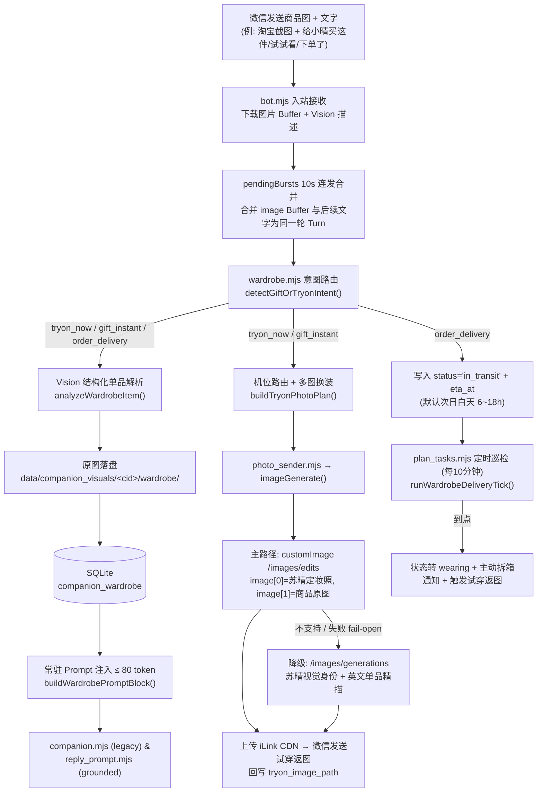
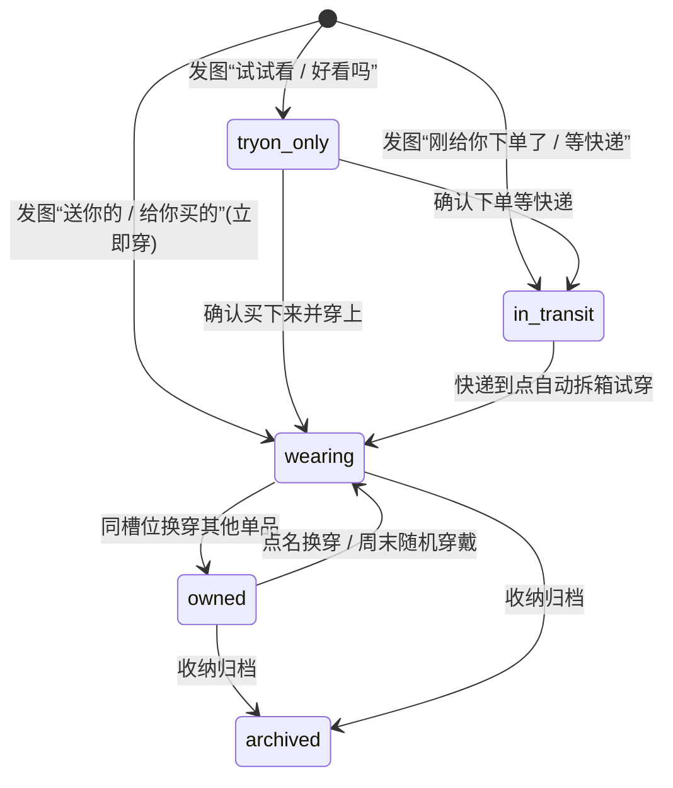

# 苏晴「数字衣橱 + 发图送礼试穿」技术架构设计

> 版本：v1.0（2026-11-28）  
> 目标：把“想送苏晴衣服、包包、鞋子等礼物”与“日常云逛街”整合成一套**微信原生、低负担、有视觉反馈、带跨周回响**的完整闭环，同时与三层相处框架（异地恋底盘 + 拍图/送礼日常连接 + 可结算约会剧场）无缝协同。

---

## 1. 总体架构与端到端数据流



---

## 2. 核心模块拆分

| 模块 | 文件路径 | 职责 |
|---|---|---|
| **数据持久层** | `src/db.mjs` | 新增 `companion_wardrobe` 表及 CRUD / 槽位切换 / 到期快递查询；删角色时级联清理 |
| **衣橱领域层** | `src/wardrobe.mjs` | 意图分类、Vision 商品卡抽取、商品原图落盘、衣橱状态机、Prompt 注入拼装、按品类机位路由 |
| **多图参考生图层** | `src/providers/custom.mjs`、`src/providers/image.mjs`、`src/ai.mjs`、`src/photo_sender.mjs` | 支持单图/多图 `referenceImages`；`custom` 主走 OpenAI `/images/edits` multipart，不支持时自动 fail-open 降级 `/images/generations` |
| **微信连发融合层** | `src/bot.mjs` | `pendingBursts` 携带入站图片 Buffer（解决微信图片与文字分两条发），在 `processUserTurn` 中自动触发衣橱入库、试穿返图与换装指令 |
| **对话注入层** | `src/companion.mjs`、`src/reply_prompt.mjs`、`src/reply_pipeline.mjs` | 在 legacy 与 grounded 两条链路统一注入精简 `【你的数字衣橱】`（今日穿搭 + 珍藏礼物） |
| **快递拆箱调度层** | `src/plan_tasks.mjs` | 每 10 分钟零 LLM 成本巡检 `in_transit` 到期包裹，到点转为 `wearing` 并主动推送拆箱 + 试穿返图；周末日程可随机抽取获赠单品穿戴 |
| **管理与参考图接口** | `src/api.mjs` | 衣橱 CRUD、单品图片安全读取、上传自定义人物定妆参考图（写入 `identity.json -> referenceImages`） |

---

## 3. 数据库设计（`companion_wardrobe`）

```sql
CREATE TABLE IF NOT EXISTS companion_wardrobe (
  id INTEGER PRIMARY KEY AUTOINCREMENT,
  companion_id INTEGER NOT NULL REFERENCES companions(id) ON DELETE CASCADE,
  slot TEXT NOT NULL,                  -- outerwear | top | bottom_or_dress | shoes | bag | accessory
  category TEXT NOT NULL,              -- 外套 | 上衣 | 裙子 | 裤子 | 鞋子 | 袜子 | 包包 | 配饰
  name TEXT NOT NULL,                  -- 如 "奶白色针织开衫"
  color TEXT DEFAULT '',
  material TEXT DEFAULT '',
  style_tags TEXT DEFAULT '[]',        -- JSON array
  visual_prompt TEXT NOT NULL,         -- 英文精细外观描述，供文生图/图生图使用
  source_image_path TEXT DEFAULT NULL, -- 商品原图路径
  tryon_image_path TEXT DEFAULT NULL,  -- 最近一次试穿返图路径
  gifted_by TEXT DEFAULT 'user',       -- user | self
  gifted_note TEXT DEFAULT '',         -- 赠言（经脱敏/称呼规范化）
  status TEXT NOT NULL DEFAULT 'owned',-- tryon_only | in_transit | owned | wearing | archived
  eta_at DATETIME DEFAULT NULL,        -- 快递预计送达时间 (UTC SQLite timestamp)
  wear_count INTEGER DEFAULT 0,
  last_worn_at DATETIME DEFAULT NULL,
  created_at DATETIME DEFAULT CURRENT_TIMESTAMP,
  updated_at DATETIME DEFAULT CURRENT_TIMESTAMP
);
```

### 槽位唯一性不变量
- 同一 `(companion_id, slot)` 下，**至多只有 1 条记录**处于 `status = 'wearing'`。
- 调用 `wearWardrobeItem(companionId, itemId)` 在同一事务内：
  1. 将同槽位原 `wearing` 单品降级为 `owned`；
  2. 将目标单品置为 `wearing`，`wear_count = wear_count + 1`，刷新 `last_worn_at`。

---

## 4. 状态机设计



---

## 5. 按品类自动机位路由（杜绝“送鞋却只拍大头”）

| 槽位 / 品类 | 推荐机位（`shotMode`） | 画幅（`aspect`） | 构图重点 |
|---|---|---|---|
| `outerwear` / `top` / `bottom_or_dress` | `MIRROR_SELFIE` | `3:4` | 宿舍/试衣间自然光对镜全身或半身试穿自拍 |
| `shoes` / 袜子 / 靴子 | `FULL_BODY_LOW_MIRROR` | `3:4` | 低机位对镜全身或镜前展示脚部穿搭，保证鞋袜完整入镜 |
| `bag` | `SIDE_CARRY_HALF_BODY` | `3:4` | 半身侧身斜挎/手拎角度，包包位于视觉中心 |
| `accessory`（帽子/围巾/饰品） | `CLOSE_SELFIE` | `3:4` | 自然近景日常自拍，突出配饰细节 |

---

## 6. 多图参考编辑与 Fail-Open 策略

1. **参考图组装顺序**：
   - `ref[0]`：苏晴人物定妆照（来自 `data/companion_visuals/<cid>/identity.json -> referenceImages`，待用户上传后自动生效）；
   - `ref[1]`：用户发来的礼物商品原图（`wardrobeItem.source_image_path`）。
2. **自定义网关兼容策略（`src/providers/custom.mjs`）**：
   - 当传入 1 张或多张参考图且 `IMAGE_EDIT_ENABLED !== 'false'` 时，优先以 `multipart/form-data` 调用 `POST <IMAGE_BASE_URL>/images/edits`（`image[]` 携带参考图字节，`model` / `prompt` / `size` 对齐 OpenAI `gpt-image-1/2` 规范）；
   - 若上游中转返回 `404 / 405 / 501` 或编辑错误，记录明确 `[WARN]` 日志并**自动降级**到 `/images/generations`（文本融合苏晴 `identitySpec` + 商品 `visual_prompt`），保证试穿链路永不因中转接口差异完全哑火。
3. **无人物参考图时的冷启动**：
   - 即使人物参考图尚未上传，商品原图仍会作为 `ref[0]` 参与编辑或提供精准 `visual_prompt`，确保上线即可体验发图试穿；一旦上传人物参考图，自动升级为「锁脸 + 锁单品」双参考模式。

---

## 7. Prompt 注入预算与红线约束

- **Token 预算**：`buildWardrobePromptBlock()` 输出严格控制在 **≤ 80 token**，仅展示当前 `wearing` 槽位与至多 4 件近期珍藏/在途单品。
- **称呼红线**：全模块提示词与入库文案严格遵守 `user_wording_guard.mjs`，使用“他 / 对方”，绝不出现“用户”二字。
- **隐私与安全**：`source_image_path` 与 `tryon_image_path` 仅在 `companion_visuals/<cid>/wardrobe/` 白名单目录内读取，API 端点强制鉴权与所有权校验（`requireAuth` + `requireOwnedCompanion`），严防路径穿越。
